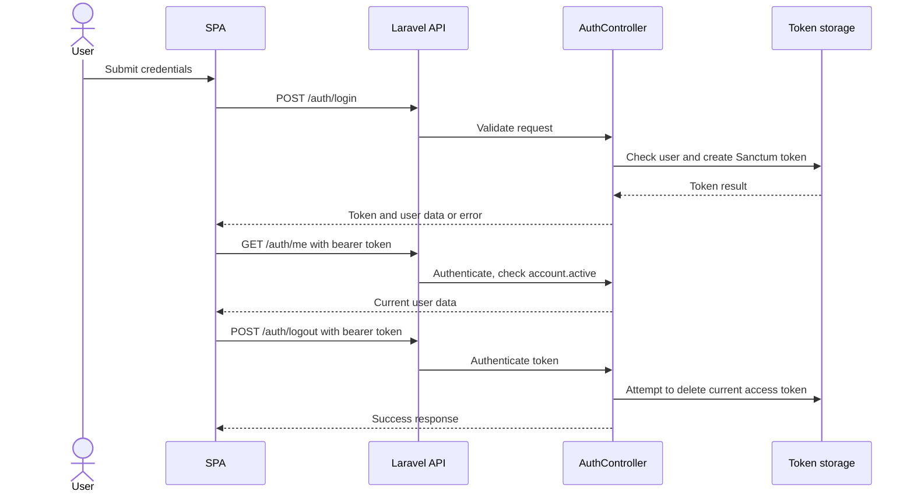

# Authentication, Session, and Logout

This diagram summarizes the controller and route declarations inspected in source. It is not runtime verification.

`/auth/me` has `auth:sanctum` and `account.active`. Logout has `auth:sanctum` only. The controller deletes the current token when the authentication context supports it; global token revocation is not implemented by this flow. The frontend keeps the token in module memory according to the inspected helper.
