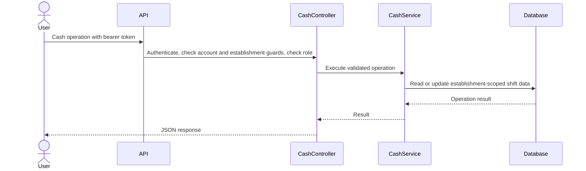

# Cash Shift Operations

The API declares open, current, movement, history, and close routes for the `ADMIN`, `MANAGER`, and `CASHIER` role group. This diagram is a high-level request path only; concurrency and accounting guarantees require separate verification.

For implementation details, inspect `backend/app/Application/Cash/CashService.php` and related SQL. No live database behavior is asserted here.
