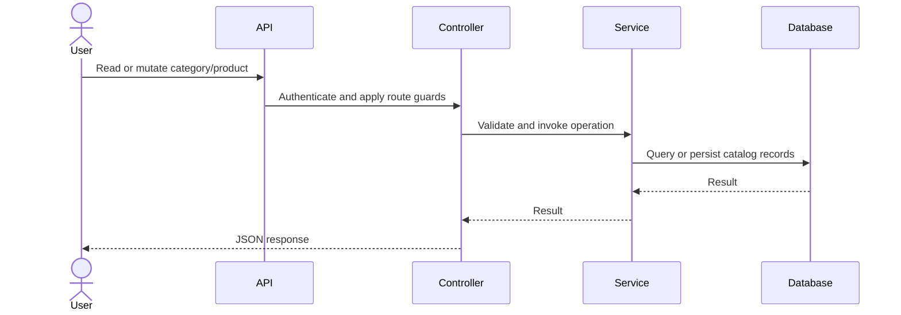

# Catalog Operations

Catalog read routes are available to `ADMIN`, `MANAGER`, `CASHIER`, and `WAITER`; catalog mutations are declared for `ADMIN` and `MANAGER`.

Tenant scoping and product/category relationship validation must be confirmed in the relevant request, service, and model code. The diagram does not claim database-level tenant integrity.
