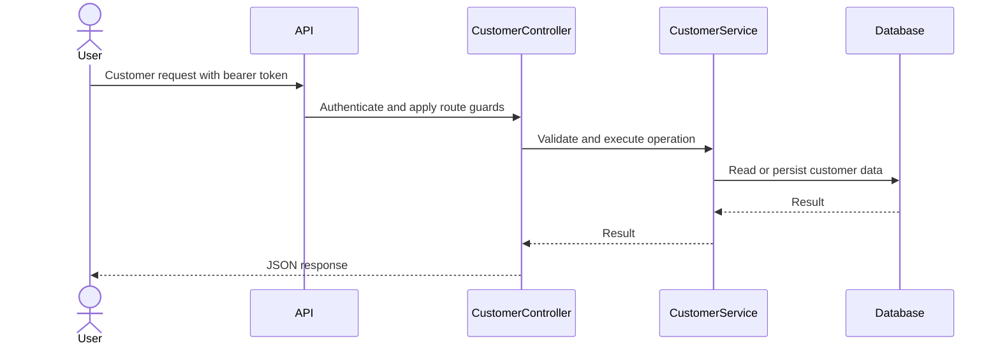

# Customer Operations

Customer reads are declared for `ADMIN`, `MANAGER`, `CASHIER`, and `WAITER`; create, update, and delete routes are declared for `ADMIN`, `MANAGER`, and `WAITER`.

Refer to the current service and request validation for exact tenant scoping and soft-delete behavior. Runtime behavior has not been exercised for this documentation update.
