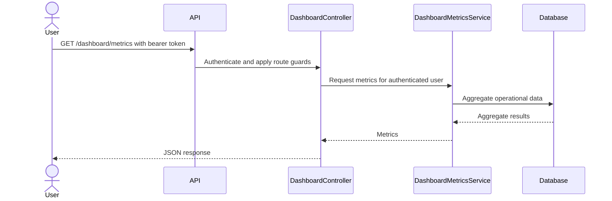

# Dashboard Metrics

`GET /dashboard/metrics` is declared for the `ADMIN`, `MANAGER`, `CASHIER`, and `WAITER` route group.

The endpoint and service are present in the inspected source. Exact metric semantics and tenant coverage should be confirmed in `backend/app/Application/` and tests; this diagram does not prove runtime results.
