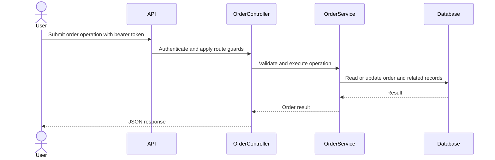

# Order Operations

The API declares order list, create, show, item addition/removal, and status update routes for `ADMIN`, `MANAGER`, `CASHIER`, and `WAITER`.

Order state transitions, snapshots, transaction boundaries, and ingredient deduction are defined across application code and versioned MySQL triggers. Consult those sources; the sequence does not define additional guarantees.
