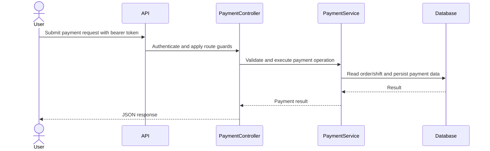

# FOOD_SERVICE Payment Registration

The inspected route declares `POST /orders/{order}/payments` for `ADMIN`, `MANAGER`, and `CASHIER`. This is the existing manual FOOD_SERVICE payment path, not a gateway integration or RETAIL payment feature.

Payment eligibility, transactionality, cash accounting, and order completion semantics must be verified in the service and SQL. This diagram does not imply a payment gateway or define a new financial contract.
