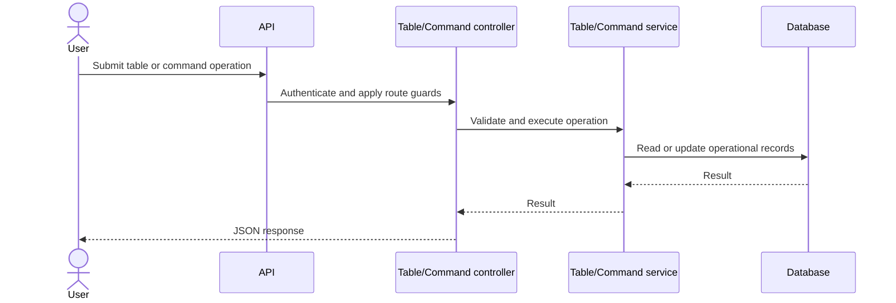

# Tables and Commands

The API declares read routes for `ADMIN`, `MANAGER`, `CASHIER`, and `WAITER`. Mutations are declared for `ADMIN`, `MANAGER`, and `WAITER`.

Check the relevant services and schema for exact state transitions and relationship rules. No cross-tenant database guarantee is inferred from route middleware alone.
